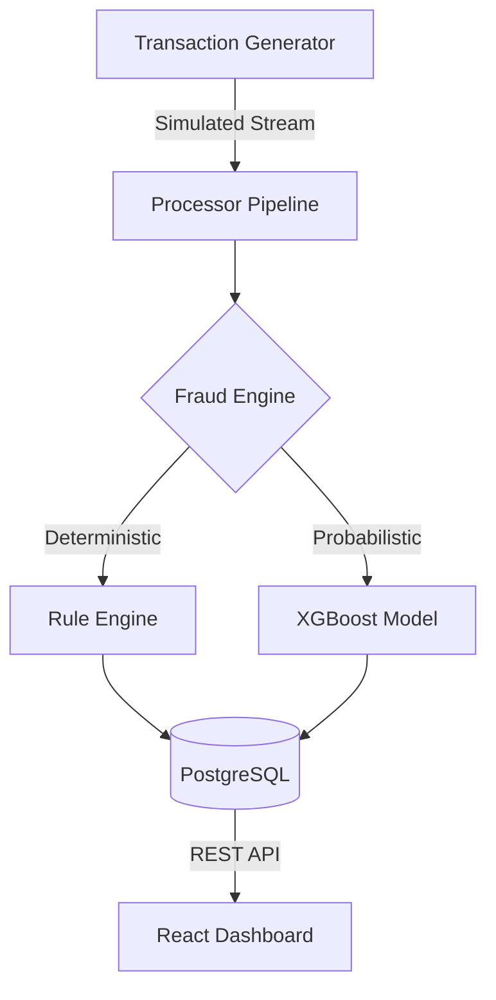

# 🛡️ FinShield — Real-Time Fraud Intelligence Platform

A production-grade hybrid fraud detection system combining a
deterministic rule engine with an XGBoost ML model to evaluate
live payment streams in real time — built to reflect production-grade fintech
infrastructure patterns for real-time payment fraud detection.


---

## Model Performance

| Metric | Score | Benchmark |
|---|---|---|
| ROC-AUC | **0.9425** | > 0.85 |
| PR-AUC | **0.9025** | > 0.70 |
| Fraud Recall | **87.8%** | > 75% |
| Fraud Precision | **71.9%** | > 65% |
| Test Set Size | 14,753 transactions | — |

---

## Tech Stack

| Layer | Technology |
|---|---|
| Stream Simulation | Python, Faker, threading |
| Database | PostgreSQL (5-table normalised schema) |
| Rule Engine | Python (3-layer: hard block / soft flag / trust boost) |
| ML Model | XGBoost + SHAP (TreeExplainer) |
| API | FastAPI |
| Dashboard | React + Vite + Recharts |

---

## Architecture



---

## How It Works

**Two-layer fraud detection:**

1. **Rule Engine** — evaluates every transaction against
   12 rules across 3 layers (hard block, soft flag, trust boost).
   Fires in < 1ms. Hard blocks never reach the ML model.

2. **XGBoost Scorer** — receives borderline transactions,
   outputs a fraud probability (0–1) with SHAP explanations
   showing which features drove the score.

**Final decision** = weighted combination (35% rules, 65% ML).

---

## Key Design Decisions

- **Z-score deviation** over fixed thresholds — personalises
  risk per user rather than applying one threshold to everyone
- **Multiplicative signal combination** — prevents noise
  accumulation from multiple weak signals crossing threshold
- **Dynamic thresholds** — adjust per user risk tier,
  account age, and transaction amount
- **Atomic DB writes** — transaction + risk_score + fraud_flag
  written in single BEGIN/COMMIT block
- **UUID transaction IDs** — app-generated before insert,
  enabling pre-referencing in batch operations

---

## Dashboard Pages

| Page | What It Shows |
|---|---|
| Live Feed | Real-time transaction stream, status, risk scores |
| Merchant Insights | Fraud rate by category, top risky merchants |
| Risk Analytics | Hourly heatmap, score distribution, device breakdown |
| Model Insights | Rule trigger counts, SHAP explanations, flagged cases |

---

## Run Locally

### Prerequisites
- Python 3.10+
- PostgreSQL 14+
- Node.js 18+

### 1. Clone & configure environment

```bash
git clone https://github.com/yourusername/finshield.git
cd finshield

# Copy the example env file and fill in your DB password
cp .env.example .env
# Edit .env and set DB_PASSWORD=your_postgres_password
```

### 2. Install Python dependencies

```bash
pip install -r requirements.txt
```

### 3. Database setup

```bash
# Create the database (run once)
psql -U postgres -c "CREATE DATABASE finshield;"

# Apply schema
psql -U postgres -d finshield -f schema.sql
psql -U postgres -d finshield -f finshield/schema_patch_v2.sql

# Seed with historical data
cd finshield
python seed_data_v2.py
```

### 4. Train the ML model

```bash
# Run from inside the finshield/ subfolder
python ml_model.py
# Saves trained model to finshield/models/ (git-ignored — train locally)
```

### 5. Start the pipeline (Terminal 1)

```bash
python processor.py
```

### 6. Start the API (Terminal 2)

```bash
uvicorn api:app --reload
```

### 7. Start the dashboard (Terminal 3)

```bash
cd ../dashboard
npm install && npm run dev
# Open http://localhost:5173
```

---

*Built as a portfolio project demonstrating data engineering,
applied ML, and full-stack development in a fintech context.*