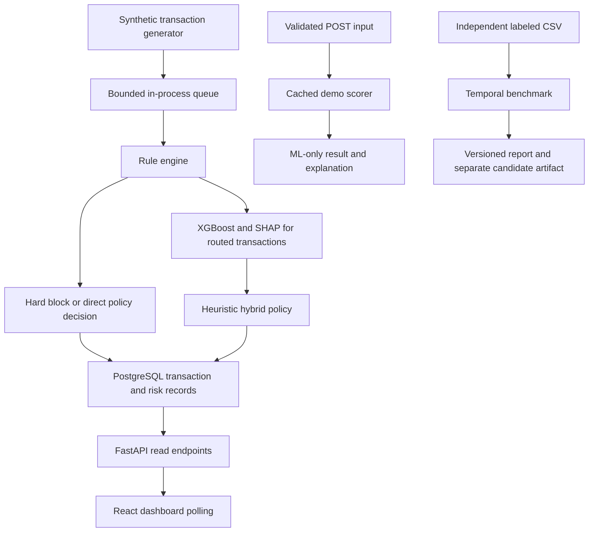

# FinShield engineering report and interview guide

## 1. A clear explanation of the project

FinShield is a learning system for detecting suspicious payment transactions.
It has two purposes: demonstrate an end-to-end synthetic transaction pipeline,
and provide an offline experiment runner for independently labeled fraud data.
They share the problem domain but have separate feature and model contracts.

A useful 60-second interview explanation:

> I built a fraud-detection demo with a Python transaction simulator, a rule
> engine, XGBoost scoring, SHAP explanations, PostgreSQL storage, a FastAPI API,
> and a React dashboard. I discovered that the original training labels were
> generated by the same policy the model was supposed to improve. I therefore
> labeled those results as policy imitation and implemented a separate evaluation
> workflow with chronological splits, simple baselines, validation-only threshold
> selection, and reproducible artifacts. The project demonstrates both application
> engineering and how to avoid making unsupported ML claims.

Do not call this a deployed banking system or claim real-world fraud detection
results until independently labeled evaluation supports those claims.

## 2. Architecture and transaction lifecycle

1. The simulator constructs transactions with user and merchant context.
2. The rule engine checks signals such as velocity, unusual spending and merchant risk.
3. A hard block takes precedence. Other transactions may be routed to ML by the processor.
4. ML preprocessing produces 25 numeric features. XGBoost returns a score and SHAP
   explains feature contributions for that model output.
5. Where ML is used, the demo combines rule and ML scores with 35/65 weights.
6. The writer persists transaction, score and fraud-flag information atomically.
7. The dashboard polls APIs; it is not a WebSocket stream.
8. The new prediction endpoint offers the ML component directly for interactive experiments.

The API endpoint does not reconstruct velocity histories or run the full hybrid
policy. Calling it a full transaction authorization endpoint would be inaccurate.

## 3. Why the original evaluation needed correction

The historical loader joins transaction decisions to current user and merchant
context. `APPROVED` becomes label 0; `FLAGGED` and `BLOCKED` become label 1.
Those are policy actions, not confirmed fraud outcomes. A legitimate transaction
can be flagged, and an approved transaction can later be found fraudulent.

Consequences:

- A high score can mean the model learned the synthetic rules successfully.
- Using the same input signals to generate labels and train the model creates
  circular evidence, even without literally including the label as a feature.
- Current merchant fraud rates and user summaries may include information that
  was unavailable at historical transaction time.
- Random splits can obscure temporal changes and shared customer patterns.

Changes made: the demo now states this limitation in saved metrics and prediction
responses; its evaluation split is chronological; class weights come from training
rows only. Test rows are no longer passed as the training progress evaluation set.
These changes improve hygiene but do not turn proxy labels into ground truth or
fix current-context leakage. Historical feature snapshots remain future work.

## 4. The independent benchmark protocol

Input is a CSV containing numeric event time `Time`, binary externally supplied
label `Class`, and explicitly selected numeric features. Dataset provenance is a
required argument, not automatically verified proof of independence.

Steps:

1. Validate required columns, binary labels and numeric/finite observed values.
   Feature NaNs are allowed and imputed; infinite values are rejected.
2. Divide distinct timestamps chronologically into approximately 60% training,
   20% validation and 20% test. Equal timestamps remain in one partition.
   Row proportions may differ when many events share a timestamp.
3. Require both classes in each partition. Reject unsuitable data instead of
   silently reverting to a random split or producing undefined AUC metrics.
4. Fit median imputation on training data only. Logistic regression also fits
   standardization on training data only.
5. Train a prior classifier, balanced logistic regression, and weighted XGBoost.
6. For each candidate, find the validation threshold minimizing
   `false_positives × FP_cost + false_negatives × FN_cost`.
7. Choose the model with the lowest validation cost per transaction.
8. Freeze that choice and its threshold before evaluating test scores.
9. Persist the selected fitted pipeline, feature order, threshold, dataset hash,
   JSON metrics, artifact hash and resolved dependency versions.

The threshold sweep sorts scores and examines the end of each equal-score group.
It includes the policy that alerts on nothing. Its complexity is O(n log n),
rather than rescoring the full dataset for each of n thresholds. If costs tie,
the higher threshold wins, reducing alerts under equal measured cost.

Thresholds are not restricted to 0–1: the predict-none threshold is just above the
maximum observed score, which is important for classifiers that output 1.0.

The test set is a final estimate, not a tuning dashboard. If you repeatedly adjust
features after inspecting test results, reserve a new final holdout.

## 5. Engineering decisions and alternatives

| Decision | Why this choice | Alternative and tradeoff |
|---|---|---|
| Separate demo and benchmark | Prevents synthetic-policy results from being confused with independent evaluation; feature schemas can differ | Replacing the live model with a public dataset model would break its raw-input contract unless a new adapter is designed |
| Chronological split | Better matches training on past data and predicting future events | Stratified random split preserves prevalence but can hide temporal leakage; grouped user splits address a different generalization question |
| Equal timestamps stay together | Avoids splitting one event-time group across boundaries | Row-based slicing is simpler but can cross the same timestamp |
| Logistic regression baseline | Cheap, interpretable, useful evidence of whether nonlinear complexity helps | Starting with neural networks adds tuning burden without evidence of a tabular-data advantage |
| XGBoost candidate | Handles nonlinear interactions in tabular features and supports TreeSHAP | A deep network may suit sequences or embeddings, but this project has neither validated sequence labels nor a large-scale training requirement |
| Prior baseline | Reveals prevalence and the behavior of trivial constant-score policies | Omitting it makes absolute model scores harder to interpret |
| Train-only class weighting | Makes minority-class mistakes matter without generating synthetic feature vectors | SMOTE can be useful but risks unrealistic tabular examples and leakage if applied before splitting; it was not evaluated here |
| Median imputation in pipelines | Keeps learned preprocessing inside the artifact and avoids fitting on validation/test | Dropping missing rows discards potentially informative examples; missingness features could be evaluated later |
| Cost-based threshold selection | Makes the recall/false-positive tradeoff explicit | A 0.5 threshold assumes score semantics and costs that may not hold; fixed-FPR or review-capacity policies are reasonable future experiments |
| Fixed, small model configurations | Makes the first benchmark understandable and inexpensive | Broad hyperparameter search risks overfitting validation and adds compute; nested temporal tuning is future work |
| Explicit feature allowlist | Prevents accidental inclusion of every CSV column, including IDs and obvious outcomes | Automatic feature selection cannot know whether a column was available at decision time; manual audit is still required |
| Local JSON/joblib experiment artifacts | Provides portable results without operating an experiment-tracking server | MLflow would help collaboration and registry management at larger scale; it is unnecessary infrastructure for the current project |
| Cached API scorer | Avoids loading artifacts per request | Startup loading fails earlier but requires a trained model even for read-only dashboard access; lazy loading supports both workflows |
| Strict request shape and numeric ranges | Rejects unsupported categories, extra fields and invalid numeric inputs before scoring | Fully permissive dictionaries defer errors until feature engineering and make API contracts unclear |
| PostgreSQL | Supports relational joins and atomic writes across the demo records | Kafka is a durable event transport, not a substitute for relational storage; SQLite would simplify setup but exercise different deployment behavior |
| In-process queue and polling UI | Appropriate for a single-process educational demo | Kafka/WebSockets offer different durability/latency properties but should follow a measured requirement, not resume keywords |
| Python unittest and GitHub Actions | Small dependency footprint with unit and real database integration coverage | A larger test framework is reasonable later; test behavior matters more than framework branding |

The live demo still encodes device categories as ordinal integers. That imposes
an artificial ordering; one-hot encoding or native categorical handling should be
compared in a controlled experiment before changing the live model contract.
Log transforms are often useful for linear models; monotonic transforms alone
usually provide little extra expressive power to trees. Engineered interactions
may help shallow trees but should be tested by ablation, not assumed beneficial.

## 6. Metrics you should understand

- **Precision = TP / (TP + FP):** among alerts, how many were labeled fraud?
- **Recall = TP / (TP + FN):** among labeled fraud, how much was caught?
- **False-positive rate = FP / (FP + TN):** what fraction of legitimate traffic was alerted?
- **Alert rate:** what fraction of all traffic requires action or review?
- **Average precision:** summarizes the precision-recall ranking curve. The report
  uses sklearn average precision, not trapezoidal integration; call it AP precisely.
- **ROC-AUC:** useful for ranking comparison, but strong ROC-AUC can coexist with
  too many alerts when fraud is rare.
- **Cost per transaction:** `(FP × FP_cost + FN × FN_cost) / N`.

An all-legitimate classifier can have excellent accuracy on rare fraud and zero
fraud recall. Always quote prevalence, sample size, split, label provenance and
threshold beside a performance number.

Default FP=1 and FN=25 are illustrative cost units. They do not represent actual
rupee losses, analyst capacity or merchant friction. A larger FN penalty tends to
lower thresholds and increase alerts. The current objective assumes constant
cost per error; amount-dependent losses need a separate documented objective.

## 7. SHAP, calibration and policy boundaries

The live XGBoost TreeExplainer returns contributions in raw model margin/log-odds
space. A positive impact pushes the model toward the fraud class relative to its
baseline. The five displayed impacts alone do not reconstruct the whole score;
that requires all impacts plus the baseline, followed by the logistic transform.

SHAP explains the model, not the real cause of fraud. Correlated features can
share credit, and synthetic labels mean explanations may just describe policy
imitation. Do not claim causal explanations or proof a customer committed fraud.

Class weighting changes training incentives. `predict_proba` output should not be
presented as a calibrated real-world probability without calibration evaluation.
The benchmark optimizes thresholds on observed validation outcomes, so it does
not require interpreting 0.8 as an 80% fraud probability.

The existing 35/65 hybrid weights and 0.40/0.70 combined cutoffs remain heuristics.
No experiment yet demonstrates they outperform rules or ML alone on independent
labels. A fair hybrid comparison requires the same point-in-time features and
independent outcomes for every candidate. Public anonymized PCA features cannot
be fed into the existing merchant/user rules without inventing semantics.

## 8. Reproducibility and artifact boundaries

- Dataset SHA-256 identifies exact input bytes; changing row order changes the hash.
- A seed is fixed for model randomness and the synthetic fixture.
- Thread count is bounded to two for XGBoost to avoid uncontrolled CPU use.
- Experiment reports record partitions, features, costs, thresholds and versions.
- Existing named experiment artifacts are not overwritten.
- Joblib preserves preprocessing together with the chosen estimator. Only load
  artifacts you trust: pickle/joblib deserialization can execute code.
- The benchmark candidate is not automatically deployed. Promotion requires a
  compatible input contract, acceptance criteria and an explicit operational step.
- Fixed seeds do not guarantee byte-identical models across different libraries,
  operating systems or hardware. Preserve the resolved requirements and environment.

The seed script now seeds Faker as well as Python randomness and converts database
NUMERIC values to floats at the context boundary. It is reproducible within a fixed
environment but still uses current dates/times; it is not a fixed historical dataset.
It must only run once per fresh demo database; this change does not make it an upsert.

## 9. Concrete changes in this revision

- Added independent temporal benchmarking, three baselines, cost-aware thresholds,
  explicit model selection, dataset/artifact hashes and dependency manifests.
- Added tests for temporal separation, tied scores, threshold optimality, cost
  sensitivity, metric counts, repeatability and artifact loading.
- Added a loaded-artifact SHA-256 fingerprint to prediction responses.
- Added validated ML-only prediction and database health endpoints, with tests for
  invalid inputs, missing models and database outages.
- Fixed feature engineering mutating its caller and losing nondefault row indices.
- Fixed decimal/float seeding failure and hard-block demo printing missing keys.
- Made seed sanity-check failures propagate; use the active Python interpreter.
- Made model paths independent of shell working directory, with an optional
  FINSHIELD_MODEL_DIR override for isolated validation.
- Corrected training class-weight calculation and temporal demo evaluation.
- Repaired the frontend lockfile; npm ci now works without bypasses.
- Fixed eight lint errors and added stream error/empty-state messaging.
- Removed an unsupported hardcoded 99.8% availability claim from the dashboard.
- Added compatibility pins and CI definitions for Python, PostgreSQL and frontend.
- Replaced unsupported headline performance claims with explicit scope and commands.

## 10. Validation evidence

These checks were executed locally in the cloud workspace for this revision:

| Check | Observed result |
|---|---|
| Unit suite | 13 tests passed, including full benchmark fit/save/reload and API failure paths |
| Fresh database | Base schema and patch applied to a separate finshield_validation database |
| Direct seed script | Completed without the onboarding runtime adapter; 200 users, 50 merchants, 2,000 transactions |
| Demo training | Completed with chronological split and synthetic-label warning; saved model and SHAP explainer |
| Live processor | Ran against the fresh validation database; confirmed new persisted transactions and clean interrupt shutdown |
| Integration | Six read endpoints and a real ML/SHAP POST prediction passed using the validation database/model |
| Frontend clean install | npm ci passed with repaired lockfile |
| Frontend quality | npm run lint and npm run build passed; build retains a large-chunk advisory |
| Benchmark smoke | Full run on a deterministic 3,000-row Gaussian fixture completed |

Demo chronological holdout: ROC-AUC 0.9237 and AP 0.8928 on this seed run.
These are synthetic-policy imitation numbers, not claims about real fraud.

Synthetic benchmark wiring check: 1,800 training / 600 validation / 600 test rows.
Validation cost selected logistic regression. Its test AP was 0.3421, recall
0.9535, FPR 0.3788 and cost/transaction 0.435 using illustrative costs 1 and 25.
XGBoost test AP was 0.3510 and cost/transaction 0.4883. Higher AP did not make it
best for the chosen operating objective. The selected logistic model still alerts
on 42% of test traffic: high recall by itself does not mean a practical system.
These values describe a Gaussian smoke fixture and must not go on a resume as
fraud-detection performance.

Hosted CI has not been run by this work. No public dataset evaluation, deployed
service load test, browser automation, production monitoring or security audit
was performed. Tests with mocked API dependencies are distinguished from the
integration run that loaded the actual model and queried PostgreSQL.

## 11. Interview questions and strong answers

**Why XGBoost instead of deep learning?**
The inputs are structured numeric/context features. Boosted trees are a strong,
inexpensive baseline for that setting, but I compare them against logistic
regression instead of assuming complexity wins. Sequences, embeddings or a much
larger dataset could justify exploring neural models later.

**How did you prevent leakage?**
The benchmark splits by event time before fitting preprocessing, excludes time
and labels from the feature list, derives class weights from training only, and
selects thresholds on validation only. That does not automatically guarantee
point-in-time feature correctness or independent labels; those require a dataset
audit. The live demo's current-context joins remain a documented limitation.

**Why not oversample first and then split?**
That can put related synthetic examples into both train and test. I used training
class weights instead, which avoids generating samples. Any future resampling
must happen within the training partition or training folds only.

**Why not use accuracy or a 0.5 threshold?**
Fraud is imbalanced and false positives have operational cost. I report AP,
precision/recall, FPR, alert volume and confusion matrices, then choose a threshold
using explicit validation costs. A threshold of 0.5 has no universal business meaning.

**Did the hybrid approach outperform rules?**
That has not been established on independent labels. The live combination is a
heuristic demonstration. An honest next experiment compares all policies on the
same independent outcomes and feature snapshots rather than reusing policy labels.

**What happens if the model is missing?**
The prediction endpoint returns 503 and the read-only dashboard can still operate.
Invalid input returns 422 before loading the model. The model is cached per worker;
retraining does not hot-reload an existing worker. Restart workers for model replacement.

**How would you deploy this responsibly?**
First obtain independent evaluation and an input-compatible model artifact. Add
artifact provenance, authentication, rate limits, structured request/decision logs,
latency/error metrics, drift and delayed-label monitoring, and a rollback path.
Start in shadow mode before allowing decisions to affect customers.

**Why no Kafka or MLflow?**
Current volume and collaboration requirements do not justify those services.
I prioritized testable boundaries and evaluation correctness. Kafka would address
durable/replayable ingestion and MLflow would address collaborative experiment
tracking; neither fixes weak labels or leakage.

**What would you improve next?**
Independent data and point-in-time feature correctness first, then capacity-aware
thresholds, calibration/error analysis by time and subgroup, and only then promotion
and serving performance. More infrastructure is not a substitute for better evidence.

## 12. Resume wording and demonstration plan

Supported wording now:

> Built an explainable fraud-detection demo using XGBoost, SHAP, FastAPI,
> PostgreSQL and React; implemented chronological model benchmarking against
> logistic and prior baselines, validation-selected cost thresholds, reproducible
> model artifacts, and automated unit/integration checks.

Do not attach real-world detection or availability percentages to that bullet.
After an independent benchmark, replace general wording with measured results,
including dataset, temporal holdout, recall/FPR or cost objective and baseline.

A five-minute demo:

1. Explain the two workflows and why synthetic labels are not ground truth.
2. Show a live transaction and its policy decision in the dashboard.
3. POST a valid transaction through Swagger and explain one SHAP impact in log-odds.
4. Show the benchmark report: split boundaries, candidate metrics, selected threshold.
5. Show a test for leakage boundaries or tied threshold scores, then state the main
   remaining limitation and the next experiment you would run.

## 13. Remaining work, ordered by value

1. Obtain and audit a legally usable, independently labeled fraud dataset. Keep
   sensitive/raw data outside Git; record provenance and do not fabricate timestamps.
2. Execute the benchmark once with a predeclared feature set and cost objective.
3. Add point-in-time feature snapshots and delayed confirmed outcomes to the live
   system before claiming historical deployment realism.
4. Compare calibration, threshold stability, slices and drift across multiple
   chronological windows. A single short dataset cannot establish long-term robustness.
5. Add a real rule/ML/hybrid ablation only if independent data supports the rule inputs.
6. Design promotion and rollback for a compatible model contract; add observability,
   access controls, durable ingestion and load tests as requirements justify them.
